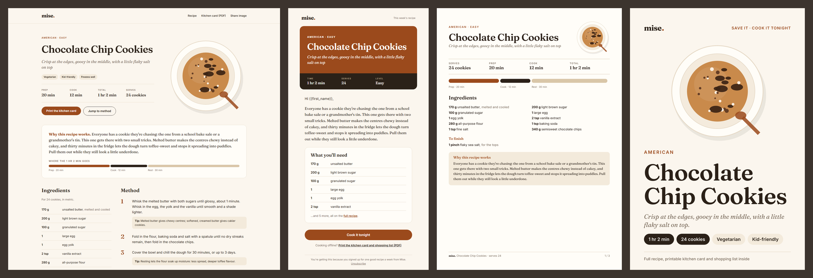
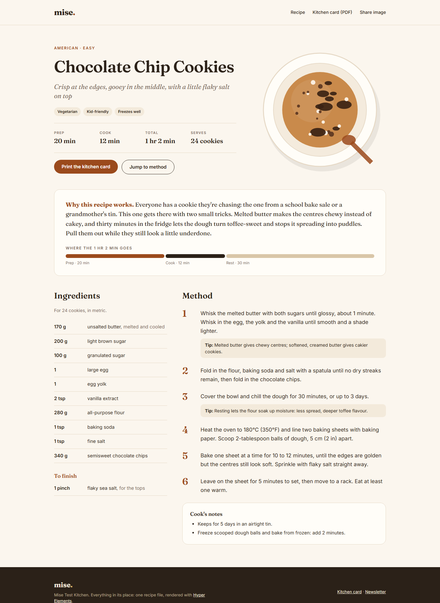
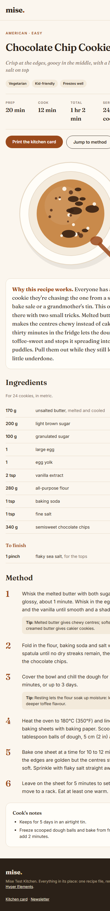
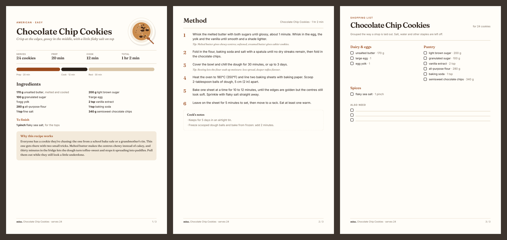
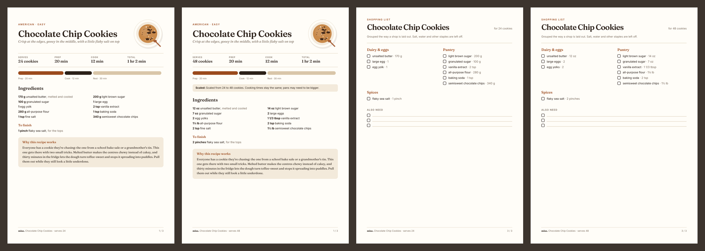
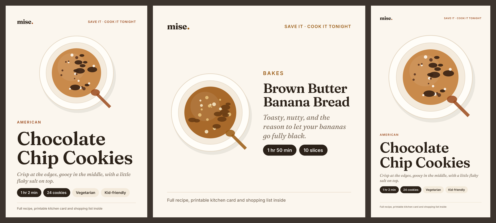
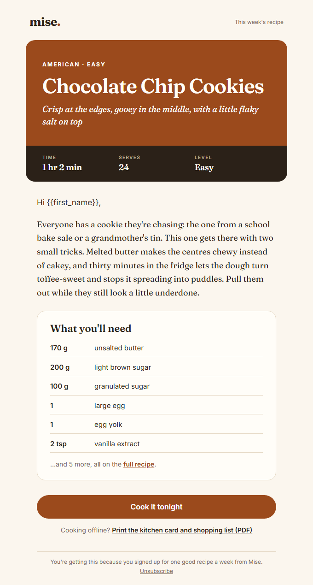
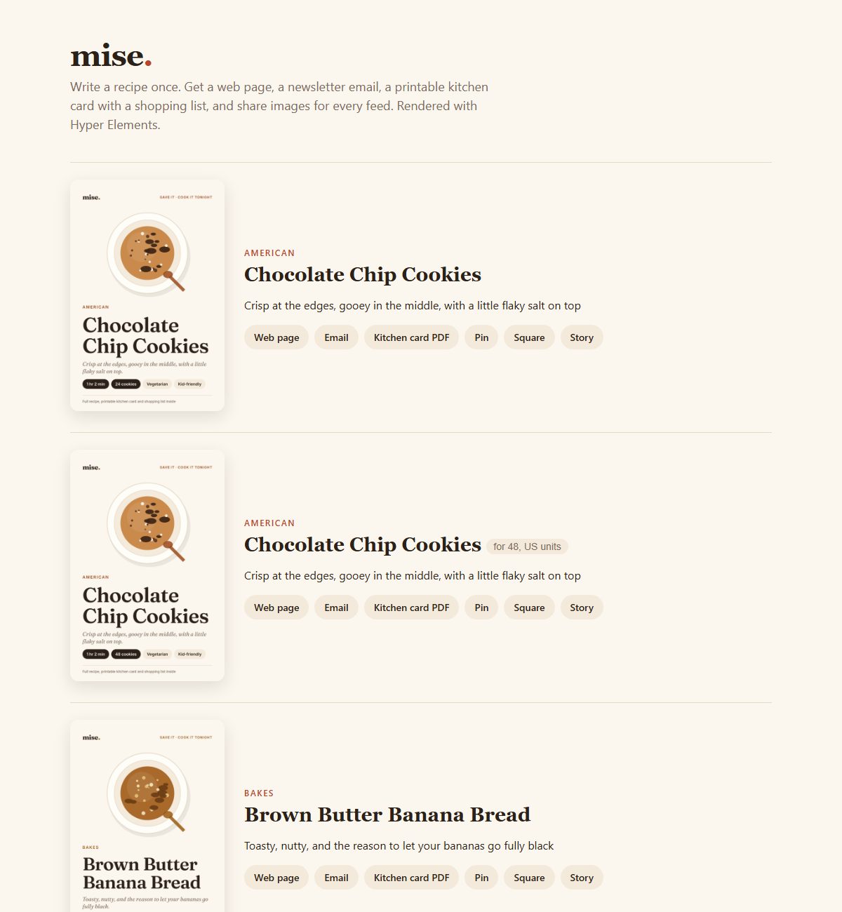
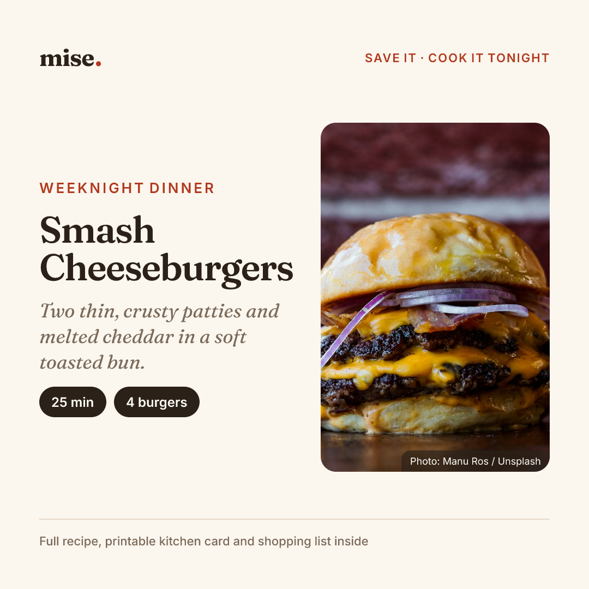

# mise. One recipe, every format.

**Write a recipe once as a small TypeScript file. Mise renders it as a web page, a newsletter email, a printable A5 kitchen card with a shopping list, and share images for Pinterest, Instagram and Stories. It scales servings and converts units along the way.**

Built with [Hyper Elements](https://www.hyperelements.dev/) for the Hyper Elements Template Challenge.

**Live preview: [nivi06-pixel.github.io/mise-recipe-kit](https://nivi06-pixel.github.io/mise-recipe-kit/)**: every output for every recipe: [web page](https://nivi06-pixel.github.io/mise-recipe-kit/chocolate-chip-cookies/) · [email](https://nivi06-pixel.github.io/mise-recipe-kit/chocolate-chip-cookies/email.html) · [kitchen card PDF](https://nivi06-pixel.github.io/mise-recipe-kit/chocolate-chip-cookies/kitchen-card.pdf) · [pin](https://nivi06-pixel.github.io/mise-recipe-kit/chocolate-chip-cookies/pin.png) · [scaled to 48, US units](https://nivi06-pixel.github.io/mise-recipe-kit/chocolate-chip-cookies-for-48-us/)



> *Mise en place*: "everything in its place". Cooks set out every ingredient before they light the stove. This kit does the same for a recipe's content: you write it once, and each format gets the version it needs.

---

## Why this exists

Recipe sites, food newsletters and home cooks all retype the same recipe three or four times: once for the blog, once for the newsletter, once as a printable card and once as a social graphic. Each copy goes stale on its own, and none of them can answer the question every cook asks: *"what if I'm cooking for eight?"*

Mise treats a recipe as **data plus kitchen math**, and treats Hyper Elements as the one layout engine for every place that recipe ends up.

| Output | File | Hyper Elements root |
|---|---|---|
| Responsive recipe page, with a time breakdown and ingredients beside the method | `index.html` | `<Page>` |
| Newsletter email: the hook, a teaser of the ingredients, a CTA, merge tags | `email.html` + `email.txt` | `<Email>` |
| A5 kitchen card PDF: recipe, method and a **tick-box shopping list grouped by aisle** | `kitchen-card.pdf` | `<Document>` |
| Share images in three sizes: pin 1000×1500, square 1080×1080, story 1080×1920 | `pin.png` `square.png` `story.png` | `<Canvas>` via `template()` |

## Preview

**Web page:** desktop and phone, from the same design (`style.mobile`, `hidden={{ mobile: true }}`, rows that stack)

<p>
  
  
</p>

**Kitchen card (PDF, A5):** three pages, with a page header and footer, page numbers, and a shopping list you can tick off



**Scaling and unit conversion:** `npm run build -- --serves 48 --us` doubles the batch and switches to cups, ounces and pounds. Every output updates: 170 g butter becomes 12 oz, 280 g flour becomes 1¼ lb, "1 large egg" becomes "2 large eggs", and the shopping list follows.



**Share images:** one template, three formats; the headline is auto-fitted to each



**Newsletter email** and **the gallery** that the build writes (it doubles as a GitHub Pages site)

<p>
  
  
</p>

The plate illustrations aren't photos. They're **generated** with Hyper Elements' `Svg` shapes from each recipe's colours and a seed, so a recipe needs no photography, and the dish looks identical in the browser, the PDF and the PNG.

---

## How Hyper Elements is used

Hyper Elements is the whole presentation layer. There is no other templating, CSS framework or headless browser in the build. Here is what each feature does in this project:

### Four roots from one codebase
- `designs/recipe-page.tsx` → `<Page>` with `breakpoints`, `Section` bands, `Row`/`Column` layout, `Menu`, `List`, `Button`, and `style.mobile` / `hidden` for phones.
- `designs/recipe-email.tsx` → `<Email>` with `previewText`, `MergeTag` (`first_name`), a merge-tag unsubscribe link and a plain-text version (`render().text`). There's no `Svg` in email, so the dish becomes a colour band instead.
- `designs/kitchen-card.tsx` → `<Document size="A5">` with `PageFooter`, `<PageNumber />` / `<PageNumber total />`, `PageBreak`, `Grid columns={2}`, and `Svg` tick boxes. Rendered with `renderPdf()`.
- `src/share-card.tsx` → `<Canvas>` rendered with `renderImage()`.

### One theme, recoloured per recipe
`src/theme.ts` defines the kitchen brand once with `defineTheme()`: colour roles, `fonts.heading` / `fonts.body`, a heading type scale (`elements.Heading.by.level`), Button defaults plus a `ghost` **variant**, and named **styles** (`card`, `eyebrow`, `chip`) used through `style={{ apply: ["card"] }}`. Each recipe gets its own accent through `extendTheme(mise, { colors: { primary: recipe.accent } })`, and every output follows. The dark page footer uses a **scoped token override** (`<Section tokens={{ colors: { … } }}>`), and designs read values with `token("colors.muted")`.

### A real `template()` with formats, typed fields and checks
The share image is a Hyper Elements **template** (`@hyper-elements/react/template`):
- **Three `formats`** (pin, square, story) from one `render(values, { format })`. The square switches to a side-by-side layout.
- **Typed fields** (`prop.text` with `maxLength`, `prop.color`, `prop.list` with `min`/`max`), each with a `label`, a `description` and `guidance` for whoever fills it in.
- **`fit`** on the `Heading` and the hook `Text`, so a long dish name steps down through sizes instead of overflowing.
- `ShareCard.check(values)` runs before every render in the build; bad values never reach an image.
- `ShareCard.describe()` is written to [`docs/share-card.template.json`](docs/share-card.template.json): a JSON Schema plus guidance that a CMS form or an AI agent can fill.

That makes the template usable **without writing code**, through the Hyper Elements CLI:

```bash
npx hyper-elements design new src/share-card.tsx -o examples/masala-chai.values.json \
  --set "title=Masala Chai" --set "hook=Ginger, cardamom and black tea, boiled hard the way the chaiwala does it." \
  --set "totalTime=15 min" --set "serves=2 cups" --set seed=masala-chai \
  --set "accent=#7A4A1F" --set "base=#F2E6D6" --set "food=#B07A4A" \
  --set 'garnish=["#5B3417","#E9D3B0","#3E7B3A"]'
npx hyper-elements render examples/masala-chai.values.json --out examples/out
```



If a value breaks a rule (no garnish colour, a 60-character title), `design new` refuses to write the file and names the field.

### Diagnostics as a design partner
Hyper Elements' checks caught real problems while this kit was being built, and each one shaped the final design:
- `image/overflow`: the chip row ran 125 px past the square image's edge (images can't wrap rows), so the square now shows only the two key numbers.
- `layout/shrunk`: the A5 card's content is 480 px wide, not the 487 px I'd assumed.
- `email/unsupported`: `justifyContent: "space-between"` doesn't exist in email.
- `email/lint-contrast`: the hero subtitle was 4.31:1, so it now uses the accent colour to pass 4.5:1.
- `template/changed`: a values file records a hash of the template it was made with, and warned when the template changed under the same version.

`npm run check` (`hyper-elements check designs`) currently reports **0 errors and 0 warnings** across all four designs.

### Fonts done properly for each output
`src/fonts.ts` gives the same Fraunces and Inter files three ways: WOFF2 URLs for the `Page` and `Email`, WOFF URLs on the `Document`/`Canvas` roots so the CLI can fetch them, and raw bytes from `@fontsource` for `renderPdf()` / `renderImage()`, so the build never touches the network.

---

## The kitchen math (`src/kitchen.ts`)

The part that makes the template *useful* rather than just pretty:

- **Scaling**: `--serves 48` multiplies every amount; times stay the same, and a note on the card says so.
- **Readable amounts**: 0.75 tsp becomes **¾ tsp** and 8.33 cups becomes **8 1/3 cups** (thirds and eighths are written out because most font subsets lack ⅓/⅛). 1 240 g becomes **1.25 kg**, a quarter of an egg is never printed, and counted items are pluralised ("1 large egg", "2 large eggs").
- **Units**: `--us` turns grams into oz/lb and millilitres into cups and spoons; small metric volumes become spoons.
- **Shopping list**: ingredients grouped by aisle (fruit & veg, dairy, pantry, spices…), with staples like salt and water left off.
- **Time breakdown**: prep/cook/rest drawn as a proportional bar (`Svg` + `Rect`) with labels aligned under each segment.

Covered by `npm test` (7 tests, Node's built-in test runner).

---

## Run it

Requires **Node.js 20.6+**.

```bash
git clone https://github.com/nivi06-pixel/mise-recipe-kit.git
cd mise-recipe-kit
npm install
npm run build          # every recipe, every format → docs/
```

Open `docs/index.html` to browse everything. Other commands:

```bash
npm run build -- --serves 48 --us             # bake 48, in US units (adds a folder to docs/)
npm run build -- --recipe chocolate-chip-cookies        # just one recipe
npm run dev                                   # Hyper Elements live preview of every design
npm run check                                 # Hyper Elements validation + lint, 0 errors / 0 warnings
npm test                                      # kitchen math tests
npm run example                               # render the CLI-made Masala Chai share card
```

`docs/` is committed and served by GitHub Pages: that's the [live preview](https://nivi06-pixel.github.io/mise-recipe-kit/).

### Add your own recipe

1. Copy `recipes/chocolate-chip-cookies.ts` to `recipes/your-dish.ts` and fill it in: ingredients take a `qty`, a `unit`, an `aisle`, and an optional `group` and `note`.
2. Add it to `recipes/index.ts`.
3. Pick an `accent` and the `dish` colours (bowl, food, garnish); the plate illustration and the whole theme follow.
4. `npm run build`.

---

## Project structure

```
designs/            One file per output: each default-exports a design (what `hyper-elements dev/check` load)
  recipe-page.tsx     <Page>
  recipe-email.tsx    <Email>
  kitchen-card.tsx    <Document> (A5 PDF)
  share-card.tsx      the share template's pin preview
src/
  share-card.tsx    template(): fields, formats, fit, check, describe
  theme.ts          defineTheme() + extendTheme() per recipe
  parts.tsx         Plate (generated Svg illustration), TimeBar, Tick
  kitchen.ts        scaling, fractions, units, shopping list
  fonts.ts          font files for web, email, PDF and image
recipes/            The content: one typed file per recipe
scripts/build.tsx   render(), renderPdf(), renderImage(), template check → docs/
examples/           A share card made from the CLI as a values file
docs/               Every rendered output, plus a gallery index
media/              README screenshots
tests/              Kitchen math tests
```

## Credits

- [Hyper Elements](https://github.com/hyper-elements/hyper-elements) by Unlayer: layout and rendering for every output.
- Fonts: [Fraunces](https://fonts.google.com/specimen/Fraunces) and [Inter](https://rsms.me/inter/) (SIL Open Font License), via [Fontsource](https://fontsource.org/).
- Recipes written for this project. Illustrations are generated; no third-party imagery is used.

MIT licensed. See [LICENSE](LICENSE).
